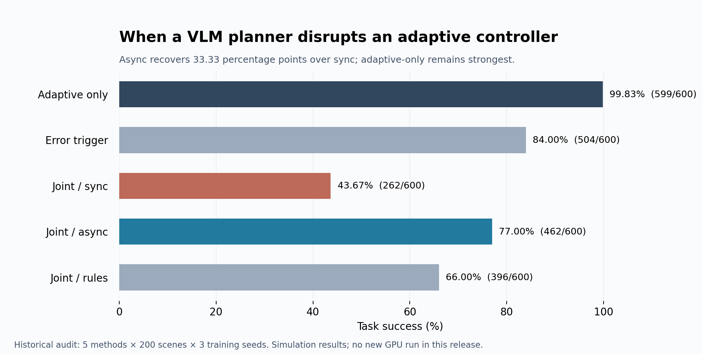
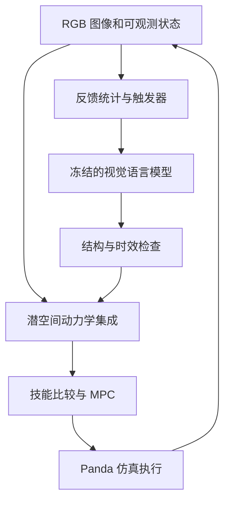

# LLM + AdaJEPA-inspired Control

**研究视觉语言模型在什么情况下能帮助自适应机械臂控制，又在什么情况下会干扰它。**

[English](README.md) · [架构与公式](docs/ARCHITECTURE.zh-CN.md) · [中文面试准备](docs/INTERVIEW.zh-CN.md) · [复现说明](docs/REPRODUCIBILITY.zh-CN.md)

本仓库整理了 Panda 机械臂三维操作项目的研究代码与历史审计结果。上层使用冻结的 **Qwen2.5-VL-3B**，根据 RGB 图像、状态和执行反馈提出候选技能；下层使用潜空间动力学模型评估技能、选择动作，并根据近期真实执行的转移数据在线更新。

核心问题是：**如何让一个速度较慢、可能输出错误的模型，与持续变化的控制系统协同工作？什么时候调用它？如何检查回复？回复到达时还适用吗？**

这里的下层是 **AdaJEPA 思路启发的自实现**，不是官方 AdaJEPA 模型、检查点或标准基准复现。视觉编码器为冻结的 ImageNet ResNet-18，同时使用仿真器提供的物体坐标，因此属于**状态辅助的视觉控制**，不是纯视觉或真实机器人实验。

## 一分钟运行

Python 3.10 及以上。离线演示无需 GPU、模型下载、API Key 或第三方依赖。

```bash
python3 scripts/demo.py --lang zh
python3 scripts/verify_data.py
python3 scripts/reproduce_results.py
python3 -m unittest discover -s tests -v
```

演示会把**历史模型回复**重新交给原始解析器，展示有效回复、结构不合格回复和过期回复。它不是实时模型调用，也没有重新运行机械臂仿真。英文演示使用 `--lang en`。

## 主要结果

随仓库提供的审计数据共 **3000 个回合：5 种方法 × 200 个场景 × 3 个训练种子**。每种方法都在相同的 600 个“场景—种子”组合上评估。

| 方法 | 成功回合 | 成功率 |
|---|---:|---:|
| 仅底层自适应，不调用 VLM（`adaptive_only`） | 599/600 | **99.83%** |
| 预测误差触发（`error`） | 504/600 | 84.00% |
| 联合触发＋同步执行（`joint`） | 262/600 | 43.67% |
| 联合触发＋异步执行（`joint_async`） | 462/600 | **77.00%** |
| 联合触发＋规则建议（`joint_rule`） | 396/600 | 66.00% |



异步执行比同步执行高 **33.33 个百分点**，但仍比仅底层自适应低 **22.83 个百分点**。这是一项有价值的负结果：**接入大模型并不自动提升原本已具备能力的控制系统。** 结论限于这个实验设置，不能推广成“大模型一定有用”或“大模型一定有害”。

源代码定义了 21 个实验组，**本次发布只提供其中 5 组的审计证据**。详见[结果与局限](docs/RESULTS.zh-CN.md)、[分任务结果](results/by_task.csv)及[来源记录](docs/provenance.json)。

## 系统如何工作



- **感知：**512 维图像特征＋12 维状态。
- **学习：**每个训练种子训练 3 个残差预测器；用近期转移数据在线适应。
- **规划：**VLM 给出 3 个候选技能；世界模型比较候选，并在 5 步预测范围内评估 32 条动作序列。
- **执行：**同步模式等待时保持当前位置；异步模式继续底层控制；限制调用次数，并拒绝过期回复。
- **评估：**固定训练、验证和测试场景种子，保存原始回复与逐回合数据，支持离线复算。

注意：VLM 给出的三个技能是**下一步技能的三个候选项**，不是依次执行的三步计划。

## 阅读顺序

| 文件或目录 | 用途 |
|---|---|
| [中文面试准备](docs/INTERVIEW.zh-CN.md) | 一分钟／五分钟讲述、追问、简历措辞、岗位迁移 |
| [架构与数学公式](docs/ARCHITECTURE.zh-CN.md) | 对照源代码理解输入、损失、规划、在线更新和异步机制 |
| [结果与局限](docs/RESULTS.zh-CN.md) | 成功率、接口失败、分任务差异，以及哪些结论尚未验证 |
| [research/experiment](research/experiment) | 保留的仿真、训练、规划、执行与日志代码 |
| [data/audit](data/audit) | 3000 条回合记录；7260 条建议记录，其中 2196 条来自规则 |
| [results](results) | 按方法、任务、条件、种子汇总，以及成对描述性结果 |
| [复现说明](docs/REPRODUCIBILITY.zh-CN.md) | 区分离线审计复算与重新开展 GPU 实验 |
| [上传 GitHub](docs/UPLOAD.md) | 中英文上传步骤 |
| [本次验证记录](docs/VERIFICATION.md) | 这次实际运行并通过的检查 |

## 项目范围

这是从数据采集到训练、规划、执行、评估与问题诊断的**端到端研究流程**。目前不包括已部署的网页产品、真实机器人验证或经过证明的安全保证。

下一步可围绕延迟、技能交接计数和结构化输出约束做受控消融；新实验应单独记录，不能覆盖本仓库的历史证据。

## 引用与说明

- [AdaJEPA 官方仓库](https://github.com/agentic-learning-ai-lab/adajepa)：提供规划过程中在线适应的研究启发，本实现与官方模型有区别。
- [Qwen2.5-VL-3B-Instruct](https://huggingface.co/Qwen/Qwen2.5-VL-3B-Instruct)：预训练多模态建议模型。
- [robosuite](https://robosuite.ai/)：机械臂任务和仿真接口。
- [ResNet-18 文档](https://docs.pytorch.org/vision/stable/models/generated/torchvision.models.resnet18.html)：视觉骨干网络。

项目所有者：**Songyuan Li（李松远）**。本展示版本使用 AI 辅助整理。面试中应按能解释、能提供证据的实际工作描述个人贡献，参见面试指南。仓库不重新分发第三方模型权重，详见 [NOTICE.md](NOTICE.md)。
